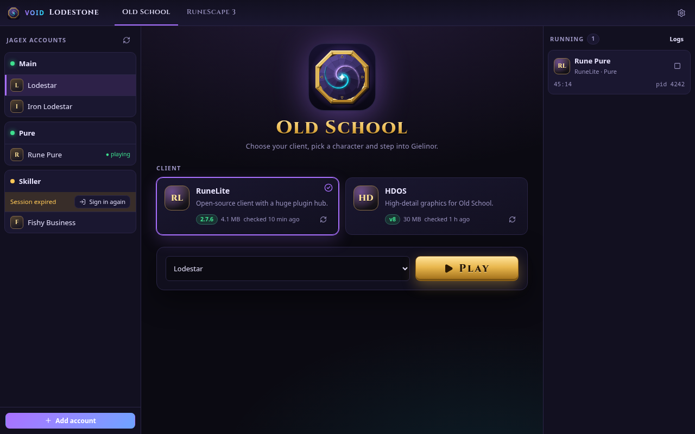

<p align="center">
  
</p>

<h1 align="center">VOID Lodestone</h1>

<p align="center">
  A fast, open-source Linux launcher for <b>RuneLite</b>, <b>HDOS</b> and <b>RuneScape 3</b>, with as many Jagex accounts as you like.<br />
  <a href="https://m4s4t0-v01d.github.io/void-lodestone/">Website</a> ·
  <a href="https://github.com/M4S4T0-V01D/void-lodestone/releases">Releases</a> ·
  <a href="https://github.com/M4S4T0-V01D/void-lodestone/issues">Issues</a>
</p>

<p align="center"></p>

## Features

- **Multiple Jagex accounts.** Sign in on Jagex's own page; every character on every account is one click away.
- **Old School RuneScape** through RuneLite or HDOS, downloaded from their official sources and kept up to date.
- **RuneScape 3**, with the GTK 2 and OpenSSL 1.1 libraries it needs bundled in the Flatpak.
- **Several games at once**, with uptime, logs and a stop button for each.
- **Tweakable:** Java options, client arguments, a custom Java, launch wrappers (`gamemoderun %command%`, `mangohud`), game home folder.
- **VOID suite look:** seven themes, from Void to Daylight and High Contrast.
- **No telemetry.** Nothing is collected or sent anywhere except to the services needed to sign in and download clients.

There is no official Old School client option: Jagex doesn't ship one for Linux, and RuneLite and HDOS run natively.

## Install

### Flatpak

```sh
flatpak install flathub io.github.M4S4T0_V01D.void-lodestone
```

Until the app is on Flathub, grab `void-lodestone.flatpak` from the [latest release](https://github.com/M4S4T0-V01D/void-lodestone/releases) and run `flatpak install --user void-lodestone.flatpak`.

### From source

Requirements: Rust (stable), Node.js 22, WebKitGTK 4.1 and its development headers. RuneLite and HDOS need Java 17 or newer; RuneScape 3 needs GTK 2 and OpenSSL 1.1.

```sh
npm ci
npx tauri build --no-bundle
./src-tauri/target/release/void-lodestone
```

For development, `npx tauri dev` runs the app with hot reload.

## Privacy and security

- You sign in on Jagex's site in a separate window. Lodestone never sees your password.
- The long-lived OAuth tokens are discarded right after sign-in. Only the game session is kept, in the Secret Service keyring (or a `0600` file if no keyring is available).
- Network traffic goes only to Jagex (sign-in, game sessions, the RS3 package), GitHub (RuneLite releases) and the HDOS CDN.
- No analytics, crash reporting or update pings.

## Where things live

| What | Native | Flatpak |
| --- | --- | --- |
| Settings and account list | `~/.local/share/void-lodestone` | `~/.var/app/io.github.M4S4T0_V01D.void-lodestone/data/void-lodestone` |
| Downloaded clients | `…/void-lodestone/clients` | same, inside the app's data |
| Game logs | `…/void-lodestone/logs` | same, inside the app's data |
| Client settings (e.g. `.runelite`) | your home folder | `…/void-lodestone/home` |

## Development

```sh
npm run lint && npm run typecheck && npm test         # frontend
cd src-tauri && cargo clippy && cargo test            # backend
scripts/preview/shoot.sh void=theme=void              # screenshots with a fake backend
flatpak-builder --user --install --force-clean build-dir flatpak/io.github.M4S4T0_V01D.void-lodestone.yml
```

After changing dependencies, regenerate the offline Flatpak sources with
[flatpak-builder-tools](https://github.com/flatpak/flatpak-builder-tools) (`flatpak-cargo-generator.py src-tauri/Cargo.lock -o flatpak/cargo-sources.json` and `flatpak-node-generator npm package-lock.json -o flatpak/node-sources.json`).

## License

VOID Lodestone is free software under the [GNU General Public License v3.0 or later](LICENSE). The Cinzel font is under the SIL Open Font License.

Not affiliated with or endorsed by Jagex Ltd. RuneScape and Old School RuneScape are trademarks of Jagex Ltd. RuneLite and HDOS belong to their respective developers.
